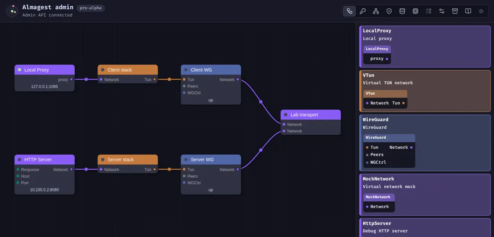

# Almagest

<!-- markdownlint-disable MD033 -->

<p align="center">
  
  
</p>
<!-- markdownlint-enable MD033 -->

Almagest is a network toolkit with a visual graph editor. It combines VPNs,
proxies, DNS services, routing, and traffic filters in one local service.
Connect nodes to define where traffic goes and how each step processes it.

Build a local proxy for one application, route host traffic through several
networks, or combine tunnels and proxies in one path.

> [!CAUTION]
> Almagest is pre-alpha software. Features and configuration can change. Do not
> use it in production.

## Features

- [VPN tunnels](https://asciimoth.github.io/almagest/docs/?page=node%2Falmagest%2FWireGuard):
  connect WireGuard and AmneziaWG peers. Use tunnels for selected applications
  or host traffic.
- [SOCKS proxies](https://asciimoth.github.io/almagest/docs/?page=node%2Falmagest%2FSocksClient):
  use SOCKS4, SOCKS4a, and SOCKS5 clients and servers. Give local applications a
  proxy into any connected network. Client transports include TLS and WebSocket;
  SOCKS5 supports TCP and UDP.
- [Routing and filtering](https://asciimoth.github.io/almagest/docs/?page=almagest%2Fprocess-filtering):
  split traffic by address, domain, port, or protocol. Match applications,
  processes, users, and groups where the platform supports them. Apply firewalls
  to packets or network operations, and remap addresses and ports.
- [DNS](https://asciimoth.github.io/almagest/docs/?page=almagest%2Fdns): combine
  static records, persistent caches, fallback resolvers, and routing rules. Send
  queries through selected networks over UDP, TCP, or TLS. Serve graph DNS to
  other clients or use it for captured host traffic.
- [Tunnel and proxy chains](https://asciimoth.github.io/almagest/docs/?page=almagest%2Ftypes):
  put a VPN through a proxy, a proxy through a VPN, or one WireGuard tunnel
  inside another. Convert between IP packets and socket operations to connect
  these layers. Each transport must support the operations required by the next
  layer.
- [Protocol inspection](https://asciimoth.github.io/almagest/docs/?page=node%2Falmagest%2FSniffer)
  and [TLS](https://asciimoth.github.io/almagest/docs/?page=almagest%2Ftls):
  route or filter TCP connections by protocol, HTTP request data, TLS SNI, or
  ALPN. Add or terminate TLS, or intercept connections for inspection. Manage
  certificates, pin keys, and limit a certificate authority's trust to selected
  domains or IP ranges.
- [Graph logic](https://asciimoth.github.io/almagest/docs/?page=almagest%2Flogic):
  combine values, variables, conditions, loops, and timed triggers. Switch
  traffic paths while the service runs. Use virtual networks and built-in HTTP
  clients and servers to test a graph. Graph logic is still work in progress.
- [Tor](https://asciimoth.github.io/almagest/docs/?page=node%2Falmagest%2FTorDriver):
  send TCP traffic through Tor, use separate circuit isolation identities, and
  publish onion services. Tor runs as a separate program under
  administrator-defined policy.
- Service clients: import Amnezia VPN service keys and self-hosted profiles with
  [Amnesia](https://asciimoth.github.io/almagest/docs/?page=node%2Falmagest%2FAmnesia).
  Connect to Tailscale or Headscale with
  [TailscaleCtrl](https://asciimoth.github.io/almagest/docs/?page=node%2Falmagest%2FTailscaleCtrl),
  including MagicDNS and firewall policy outputs.

## How it works

Nodes connect through typed ports. Almagest includes a userspace TCP/IP stack
that converts between packets and socket operations. This lets a graph connect
VPN tunnels, proxies, filters, and services at different network layers.

Each path reaches host applications or external networks through explicit
boundary nodes. Several independent paths can run in one graph, including
virtual networks for tests.

The `almagestd` service keeps the graph running when you close the editor. The
desktop app, web panel, and `almagest-cli` manage the graph, logs, secrets, DNS
caches, and TLS policies. Configuration uses HuJSON (JSON with comments and
trailing commas). Snapshots save the editable configuration and persistent data;
protected host policy stays separate.

## Platform support

Linux packages cover amd64 and arm64. The current Windows package targets
Windows Server 2022 on amd64. Host routing, process matching, and sandbox
features differ by platform. See the
[Linux package notes](./packaging/linux/README.md) and
[Windows support notes](./packaging/windows/README.md).

See
[isolation and sandboxing](https://asciimoth.github.io/almagest/docs/?page=almagest%2Fsecurity)
for the available process restrictions and their limits. Linux has experimental
integration with a
[separate kill-switch service](https://asciimoth.github.io/almagest/docs/?page=almagest%2Fkillswitch).

## Install

Download signed packages from
[GitHub Releases](https://github.com/asciimoth/almagest/releases). The
`almagest` package contains the daemon and command-line client. Install
`almagest-app` separately if you want the desktop app. Linux packages are
available for amd64 and arm64; the desktop app package is available for amd64.
The Windows amd64 MSI includes the daemon, client, and optional desktop app. See
[platform support](#platform-support) for the current Windows target.

### Debian and Ubuntu (APT)

Add the [package repository](https://repo.moth.contact/) and install both
packages:

```sh
curl -fsSLo KEY.gpg https://repo.moth.contact/KEY.gpg
sudo install -m 0644 KEY.gpg /usr/share/keyrings/ghrepo-archive-keyring.gpg
curl -fsSLo deb.list https://repo.moth.contact/deb.list
sudo install -m 0644 deb.list /etc/apt/sources.list.d/ghrepo.list
sudo apt update
sudo apt install almagest almagest-app
```

On arm64, install `almagest` without `almagest-app`.

### Fedora and other DNF systems (RPM)

Add the [package repository](https://repo.moth.contact/) and install both
packages:

```sh
curl -fsSLo rpm.repo https://repo.moth.contact/rpm.repo
sudo install -m 0644 rpm.repo /etc/yum.repos.d/ghrepo.repo
sudo dnf makecache
sudo dnf install almagest almagest-app
```

On arm64, install `almagest` without `almagest-app`. The repository also lets
APT and DNF install later updates.

### Arch Linux and Windows

Get the packages from
[GitHub Releases](https://github.com/asciimoth/almagest/releases). On Arch
Linux, download the `.pkg.tar.zst` files for your architecture and install them
with `sudo pacman -U FILE...`. Install the `almagest` package and, on amd64, the
separate `almagest-app` package if you want the desktop app.

On Windows Server 2022 amd64, download and run the `.msi` file. The installer
starts the daemon service and selects the desktop app by default. See the
[Windows package notes](./packaging/windows/README.md) for installer options.

After a native Linux package install, start the daemon:

```sh
sudo systemctl enable --now almagestd.service
```

To use the desktop app or CLI without root, add your user to the `almagest`
group, then sign out and sign in again. This group grants full control of
Almagest:

```sh
sudo usermod --append --groups almagest "$USER"
```

### Nix and NixOS

The [flake](./flake.nix) provides the daemon and CLI on Linux. With Nix flakes
enabled, add them to your profile:

```sh
nix profile add github:asciimoth/almagest#almagest
```

On x86_64-linux, you can also install the desktop app:

```sh
nix profile add github:asciimoth/almagest#almagest-app
```

For NixOS, add `almagest.url = "github:asciimoth/almagest";` to your flake
inputs. Add the module to your `nixosSystem` modules:

```nix
modules = [
  almagest.nixosModules.almagestd
  { services.almagestd.enable = true; }
];
```

The module installs the daemon and starts its service. See the examples at the
top of [flake.nix](./flake.nix) to choose a generated or editable configuration.

### Install from source

On a Debian-, RPM-, or Arch-based Linux system, install
[`just`](https://github.com/casey/just), clone this repository, and run:

```sh
just install daemon app
```

Specify `daemon`, `app`, or both. The `daemon` part includes the command-line
client. The command checks build and runtime requirements and prints package
installation commands when available. It preserves existing files in
`/etc/almagest`.

The command does not enable the service. After installation, start it with:

```sh
sudo systemctl enable --now almagestd.service
```

Open the desktop app and load **Hello Network** or **Mock Network** from
**Snapshots → Examples**. These examples do not change host routing. Loading an
example replaces the current editable configuration and data, so save a snapshot
first if you already have a setup.

## Documentation and development

The app and web panel include guides, node references, and working examples.
Start with
[Getting started](https://asciimoth.github.io/almagest/docs/?page=almagest%2Fstart),
[Nodes, ports, and links](https://asciimoth.github.io/almagest/docs/?page=almagest%2Fgraph),
or
[Service and command line](https://asciimoth.github.io/almagest/docs/?page=almagest%2Fdaemon-cli).

The engine and nodes are also available as a reusable Go library in `lib/`. See
[ARCHITECTURE.md](./ARCHITECTURE.md) for the code layout, build commands, and
tests.

## License

Almagest is licensed under the
[GNU General Public License v3.0 or later](./LICENSE).
