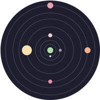

# Almagest

<svg viewBox="-101 -101 201 201" xmlns="http://www.w3.org/2000/svg">
  <circle r="100" x="0" y="0" fill="#1e1e2e" />

  <circle r="90" cx="0" cy="0" fill="#1e1e2e" stroke="#45475a" stroke-width="1" />
  <circle r="75" cx="0" cy="0" fill="#1e1e2e" stroke="#45475a" stroke-width="1" />
  <circle r="63" cx="0" cy="0" fill="#1e1e2e" stroke="#45475a" stroke-width="1" />
  <circle r="47" cx="0" cy="0" fill="#1e1e2e" stroke="#45475a" stroke-width="1" />
  <circle r="30" cx="0" cy="0" fill="#1e1e2e" stroke="#45475a" stroke-width="1" />
  <circle r="20" cx="0" cy="0" fill="#1e1e2e" stroke="#45475a" stroke-width="1" />
  <circle r="12" cx="0" cy="0" fill="#1e1e2e" stroke="#45475a" stroke-width="1" />

  <circle r="6" cx="0" cy="0" fill="#a6e3a1" class="planet" />
  <circle r="2" cx="0" cy="12" fill="#cdd6f4" class="planet">
    <animateTransform
      attributeName="transform"
      begin="0s"
      dur="4s"
      type="rotate"
      from="0 0 0"
      to="360 0 0"
      repeatCount="indefinite" />
  </circle>
  <circle r="3" cx="20" cy="0" fill="#9399b2" class="planet">
    <animateTransform
      attributeName="transform"
      begin="0s"
      dur="5s"
      type="rotate"
      from="0 0 0"
      to="360 0 0"
      repeatCount="indefinite" />
  </circle>
  <circle r="4" cx="0" cy="-30" fill="#f2cdcd" class="planet">
    <animateTransform
      attributeName="transform"
      begin="0s"
      dur="6s"
      type="rotate"
      from="0 0 0"
      to="360 0 0"
      repeatCount="indefinite" />
  </circle>
  <circle r="10" cx="-47" cy="0" fill="#f9e2af" class="planet">
    <animateTransform
      attributeName="transform"
      begin="0s"
      dur="7s"
      type="rotate"
      from="0 0 0"
      to="360 0 0"
      repeatCount="indefinite" />
  </circle>
  <circle r="4" cx="0" cy="63" fill="#f38ba8" class="planet">
    <animateTransform
      attributeName="transform"
      begin="0s"
      dur="8s"
      type="rotate"
      from="0 0 0"
      to="360 0 0"
      repeatCount="indefinite" />
  </circle>
  <circle r="6" cx="75" cy="0" fill="#fab387" class="planet">
    <animateTransform
      attributeName="transform"
      begin="0s"
      dur="9s"
      type="rotate"
      from="0 0 0"
      to="360 0 0"
      repeatCount="indefinite" />
  </circle>
  <circle r="6" cx="0" cy="-90" fill="#eba0ac" class="planet">
    <animateTransform
      attributeName="transform"
      begin="0s"
      dur="10s"
      type="rotate"
      from="0 0 0"
      to="360 0 0"
      repeatCount="indefinite" />
  </circle>
</svg>

> [!CAUTION]
> Almagest in is __pre-alpha__.  
> Current project state is extremely unstable.
> Anything can be changed without warning and docs may be outdated.  
> __Do not use in production.__

## Repeated tests

Run `just test-cycles` for an unattended test session. By default, it runs Go,
Docker E2E, and optional Windows VM tests in that order, and then repeats the
sequence. Stop with Ctrl+C, SIGTERM, or SIGHUP. `just` loads `.env`, as it does
for the other test commands. For example:

```sh
E2E_JOBS=4 E2E_INCLUDE_PRIVILEGED=1 RUN_WINVM_TESTS=1 just test-cycles
```

Set `TEST_TYPES_PARALLEL=1` to run the Go, Docker E2E, and Windows VM test
types at the same time. This opt-in setting also applies to `just check` and
`just test-e2e`. The default value is `0` to limit peak CPU and memory use.

`TEST_CYCLES_TIMEOUT` sets a hard session timeout in seconds.
`TEST_CYCLES_SOFT_TIMEOUT` sets a soft session timeout in seconds. At the soft
timeout, the command stops if any test type has failed. If no test has failed,
the command continues until the first failure and then stops. Both timeouts are
disabled when their environment variables are unset or empty. They accept
positive decimal values and include preparation time. For example:

```sh
TEST_CYCLES_TIMEOUT=21600 TEST_CYCLES_SOFT_TIMEOUT=3600 just test-cycles
```

Preparation runs once before any loop starts. It generates the certificate
catalog and web assets, prepares all selected Docker images, and, when enabled,
builds or reuses the Windows base image and stages one Windows test payload.
Windows setup needs the host dependencies and media described in
[dev/winvm/README.md](dev/winvm/README.md). A preparation failure stops the
command and prints the log location. Each Windows loop still checks its locks,
image, and new VM resources. Keep the source tree and prepared images unchanged
during the session.

The Go loop runs `certcat`, `lib`, `bin`, and the Gonnect regression tests.
It uses `-count=1 -p=1 -parallel=1`; `lib` and `bin` also use `-race`.
Docker selection and scheduling follow `E2E_JOBS`, `E2E_INCLUDE_PRIVILEGED`,
`E2E_EXCLUDE_HEAVY`, and the other E2E settings. Docker coverage defaults to off
for this runner; set `E2E_COVERAGE=1` to enable it. When `RUN_WINVM_TESTS=1`,
each Windows loop runs the ordinary and privileged native suites and the
isolated packet-flow suite. JavaScript and harness unit tests remain in
`just check`.

Each test type reports only its start, finish, duration, and completed/failed
loop counts. Test failures do not stop the cycles. All Go modules run even if
an earlier module fails. Successful-loop logs and VM disks are removed.

The command saves evidence in the gitignored `artifacts/test-cycles/run-*/`
directory. `host-resources.jsonl` records fsynced host memory, pressure, CPU,
paging, OOM, and top-process samples for the whole session. Each failed or
interrupted loop has command logs and `result.json`.
Docker loops also keep per-case logs. A Windows loop has a `vm-artifacts` link
to its retained disk and logs under `artifacts/winvm/`, which supports
`just winvm-shell`. Failed Windows runs also attempt to collect guest artifacts.
Retained failures can use substantial disk space; no failure evidence is
automatically removed.

`just check` and `just test-e2e` print a resource-evidence directory when they
start. Successful runs remove it. A failed, interrupted, or abruptly stopped
run retains it under `artifacts/test-resources/`.

On stop, including a hard or soft timeout, the command signals active process
groups and waits for the Docker and VM cleanup handlers. Docker resources have
a per-run label so the scheduler can also remove helpers left by interrupted
case cleanup. Interrupted loops are separate from completed or failed loops. It
prints and saves `report.txt` with
the source revision, worktree state,
flags, per-type counts, failure names, average successful-loop times, and evidence
paths. Copy this report to a troubleshooting agent. `loops.jsonl` contains every
loop result, including successful loops. Named failures count Go leaf subtests
or Docker cases; package failures, unidentified errors, and Windows suite-case
fallbacks are labelled. Forced cleanup timeouts are reported.
