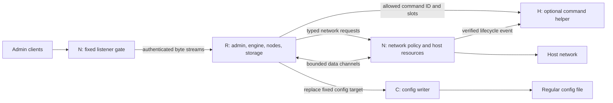

# Daemon isolation architecture

Status: proposed design. No isolation described here is implemented by this
document. The source review used Almagest commit
`a29839e5e703ab3fdc45d819af19917f0181cf24` and the dependency versions in
[`bin/go.mod`](../bin/go.mod). External sources were checked on 2026-10-06.

Run the engine, nodes, admin protocol, config reconciliation, database, and
snapshot code in a restricted process. Give host operations to small brokers
which enforce policy independently of that process. Use separate network and
config-write brokers because their access requirements differ. Add other
helpers only for a specific protected feature.

By default, preserve all supported sysnet operations available with the daemon's
launch credentials and existing protected backend settings. Additional policy
restrictions are optional. Isolation limits how the engine reaches the host;
it must not require an allowlist for ordinary TUN and network use. Running
without elevated privileges remains supported, at least with `--no-isolation`.

This design first defines process boundaries and contracts. The Linux and
Windows sections then define how to enforce them. It preserves the `lib/` and
`bin/` module split. Process management, IPC, and platform restrictions belong
in `bin/`.

The process split below applies to isolated mode. With `--no-isolation`, all
daemon roles run in the original process and use direct interface calls. No
isolation worker, broker process or internal IPC transport is started. Section
10.1 defines this execution mode and its performance requirements.

## 1. Process split

### 1.1 Process roles

| Role | Code and state owned | Authority after startup |
| --- | --- | --- |
| Runtime, R | Engine and all nodes; admin HTTP, WebSocket and stream protocols; HuJSON and ZIP parsing; config reconciliation; bbolt, DNS cache, secrets and TLS stores; snapshot operations; node logs | Read and write private application storage; use supported sysnet operations through brokers and any approved direct data handles; no direct host administration |
| Network broker, N | Host network resource registry; native resource creation/configuration; selected socket/TUN relays; route, DNS and firewall control; policy checks; small admin listener gate; lifecycle supervision | Only host network and peer-inspection access required by the selected protected features |
| Config writer, C | One startup-selected regular config target; write revision and request receipt | Read and atomically replace that target; no network, graph, database, ZIP, command, or protected-config access |
| Optional helpers, H | A fixed command profile, DNS provider integration, or process-rule backend that needs additional access | Only access required by that profile; separate from R and C |

The initial launcher is trusted bootstrap code. It reads protected settings,
opens trusted inputs, starts the required children, and installs restrictions.
It then becomes N. It does not remain a general root process launcher. After
startup, N cannot launch arbitrary children or accept a new process role. A
complete daemon restart goes through the service manager or local operator.
An optional command helper is the only role with a later execution function.

C is absent when the config is read-only. If a regular config is inside R's
private storage and needs no special permissions, R can write it directly with
the same revision contract. The normal system installation uses R, N, and C.
Debug system integration still uses a sandbox; it does not imply permission to
access the host directly.

These are authority boundaries, not a requirement that any process run as root.
N retains only authority available at launch and needed for its backend. A
normal-user launch does not request elevation, connect to a more privileged
system instance, or install a privileged service to obtain missing features.

The two N boxes show functions of the same process. They do not indicate two
network brokers. A later implementation can separate the listener gate or data
relay when measurements or a security review justify another process.

### 1.2 Security objective and limits

Assume that an attacker has full admin API access, can supply regular config
and snapshots, and can execute arbitrary code inside R after a node defect.
N, C, and H must treat every request from R as hostile. Node IDs, class names,
claimed users, and claimed callback names supplied by R prove no authority.

The attacker may use the network operations available through sysnet and the
daemon's application data, subject to any additional host policy. Launch
credentials and existing protected backend settings define the default network
authority. The attacker must not be able to gain new privileges, modify unrelated
host files, execute arbitrary
host commands, load drivers, change protected policy, or operate on foreign
network resources. The kernel, installed binaries, protected policy, service
configuration, and host administrator remain trusted.

This does not isolate one node from another inside R. A compromised R can read
its database, steal secrets available to it, corrupt snapshots, impersonate
admin replies, and disrupt its allowed network resources. Per-node storage
permissions are application rules, not a process security boundary. Isolating
nodes from each other would require a separate later design.

Network administration has real host effects. Permission to install a default
route, set DNS, inject packets through a TUN, or apply a kill switch can disrupt
or redirect host traffic. These are legitimate sysnet effects and remain enabled
by default when the backend supports them with the launch credentials. Document
them as part of the daemon's network authority. Ordinary outbound connections
also permit data exfiltration and access to reachable services. Optional policy
can restrict default routes, DNS, local/LAN/link-local/Internet destinations or
listening endpoints; it is not required to enable them.

Compromise of N remains serious: operating systems cannot generally limit all
network-administration rights to interfaces with a particular name. Reduce
N's code and permissions, but do not claim its resource registry is an OS
boundary against compromise of N itself. Kernel or driver exploits are also
outside the guarantee, though syscall and device restrictions reduce exposure.

### 1.3 Why not two unrestricted halves

Moving all of `platform/` into a root helper would combine network authority,
file access, DLL loading, command execution, and config parsing. Forwarding
those functions through generic RPC would preserve too much authority.

Putting the admin API in another process before separating these powers would
add a large engine API transport without strengthening the host boundary: the
threat already includes a malicious authenticated admin. Keep admin orchestration
with R initially. Keep protocol parsing out of the privileged listener gate.

## 2. Current code and required boundaries

| Current implementation | Consequence for the split |
| --- | --- |
| [`main.go`](../bin/almagestd/main.go) reads config, changes directory to storage, restores startup snapshots, opens bbolt, creates admin listeners and command runner, constructs the system, then builds the engine | Split trusted bootstrap from restricted application initialization. Do not extract this whole sequence into a privileged parent |
| [`platform.DropPrivileges`](../bin/almagestd/platform/platform.go) only logs a warning | There is no existing privilege-drop guarantee to preserve |
| [`lib.BuildEngine`](../lib/engine.go) receives `sysnet.System` and storage interfaces | Supply an IPC system adapter in isolated mode and the direct backend in `--no-isolation`. Keep the engine independent of daemon packages |
| [`daemonservices/localnetwork`](../bin/almagestd/daemonservices/localnetwork/) and native platform constructors create `sysnet-linux` and `sysnet-windows` systems | Direct mode owns host control through the local network service. Isolated mode must place it behind N. Audit dependency constructors as well as exported methods |
| [`api*.go`](../bin/almagestd/api.go), Formular, node name management and logs are daemon code | They run in R even though they are under `bin/` |
| [`config_autosave.go`](../bin/almagestd/config_autosave.go) reconciles the graph before writing config; failed updates attempt rollback | R owns this transaction. C only supplies fixed-target persistence |
| [`snapshots.go`](../bin/almagestd/snapshots.go) parses archives, mirrors storage, restores bbolt, reapplies immutable state and rebuilds nodes | All archive and restore work runs in R, including `--snapshot` startup restore |
| [`platform.Agent`](../bin/almagestd/platform/platform.go) combines reading protected config with writing regular config | Replace its runtime use with separate bootstrap input and config-writer contracts |
| [`command/`](../bin/almagestd/command/allowlist.go) already has named commands and bounded slots; [`node_command.go`](../bin/almagestd/node_command.go) exposes entries with `AllowNodes` | Enforce `AllowNodes` in H, independently of the node catalog. Do not send raw argv across IPC |
| [`callbacks_linux.go`](../bin/almagestd/platform/callbacks_linux.go) maps backend events to commands | Only N may issue callback requests. Derive slot values from N's committed resource state |
| [`config.go`](../bin/almagestd/config.go) reads protected secrets from environment and TLS material from files | Resolve exact inputs at bootstrap. Give R only the data it needs, without a file-read API |
| [`experimental/tor_backend.go`](../lib/experimental/tor_backend.go) constructs a direct host integration | Leave it unchanged for now; require `--experimental --no-isolation` |

The reviewed interfaces are Gonnect `v0.56.0`, sysnet-linux `v0.8.1`, and
sysnet-windows `v0.5.0`. They already carry capability reports, validation,
warnings, resource lifecycle, and network abstractions. They are suitable
adapter contracts, but are not a wire format or security policy.

`gonnect.Network.IsNative()` explicitly permits consumers to bypass methods
with low-level operations. `tun.Tun.File()` can expose a device descriptor.
IPC adapters must return `IsNative() == false`; a proxied TUN returns nil from
`File()`. Preserve errors, deadlines, batching, close, and event semantics.
Audit consumers that use native fast paths, including WireGuard and UDP code.
Do not silently create native sockets when an adapter method is unsupported.

These proxy requirements do not apply to the direct backend in `--no-isolation`.
Its outbound network may report `IsNative() == true` when the backend supports
native access. Preserve the backend's native TUN file and socket fast paths
where applicable. Do not force native status to false merely to share an
interface with an IPC implementation. A virtual network or a wrapper whose
behavior must not be bypassed still reports its correct native status.

The native dependencies also combine privileged control with data processing.
For example, Linux DNS providers parse and forward DNS, and some run
`resolvconf`; Windows provides a managed DNS proxy. Separate DNS protocol work
into R and retain only host DNS configuration in N or a dedicated H. Wrapping
an unchanged native `System` wholesale is a migration prototype, not the final
small privileged surface.

## 3. Protected policy and permitted effects

### 3.1 Source of authority

Separate mandatory broker validation from optional restrictions on legitimate
sysnet behavior. Mandatory validation covers typed operations, resource
ownership, bounds, lifecycle and the absence of generic privileged APIs. The
default permits every implemented sysnet operation and argument combination
which the backend supports in the current environment, within those contracts.
This includes TUN creation and management, supported routes/DNS/rules, outbound
traffic, and listening on any address and port the relevant network can use.
Do not require separate opt-ins for privileged ports or default-TUN use.

Introduce optional protected isolation settings during implementation. This
document does not add schema fields. Their exact names must be reviewed with
the implementation. Settings cover:

- Process identities, sandbox profile, storage locations and resource limits.
- Optional limits on TUN types, count, names, address ranges, route ranges and
  MTU range, beyond the backend's own validation.
- Optional denial of default-route takeover, host DNS changes, strict mode,
  or specific include/exclude rule types.
- Socket purposes and optional protocol, local bind, destination and multicast
  limits, plus maximum live sockets and listeners.
- Fixed marks, routing tables, firewall ownership scope and native driver
  feature selection. R cannot set these values.
- Allowed node commands, separate backend callbacks, and their profiles.
- Failure policy, including whether a strict traffic block must survive loss
  of R, N, or the IPC connection.

Parse policy once in trusted bootstrap, reject unknown security fields and
duplicate keys, normalize it, and distribute only the required parts to each
broker. Give each session a policy digest and protocol version. A digest is a
consistency check, not proof that R obeys the policy. Every broker enforces its
own copy. Changes that expand authority require a host-controlled restart.

An absent optional restriction preserves backend behavior. An unknown wire
operation is always rejected; supporting the sysnet contract does not authorize
arbitrary OS operations. Commands outside that contract still require explicit
protected entries. Optional restricted profiles may be supplied, but the default
is full supported sysnet functionality, not a proxy-only or separately enabled
VPN profile. Resource quotas protect availability and must accommodate ordinary
workloads; hitting one returns a specific limit error.

Compute effective capabilities from the backend under the launch authority,
any optional restrictions, and the implemented isolation adapter. Preserve
backend states, reasons, warnings and allowed attempts for unknown capabilities;
do not flatten them into a root/non-root check. For example, the reviewed Linux
constructor in sysnet-linux `auto.go` probes features independently and can
report `unavailable` with `permission_denied` when TUN privileges are absent.
It does not need to fail system construction or disable unrelated sockets.

Probe and verify in the broker's final restricted environment as well as during
bootstrap. Retain the rights needed for later supported operations, not just
resources present in the first graph. If the isolation implementation loses a
feature that the same backend and launch authority otherwise provide, record
that as an isolation compatibility gap, not as an operator policy choice or a
successful preservation of behavior. Resolve such gaps before qualifying that
profile. Never acquire more host authority to compensate for missing launch
privileges.

Regular config, database values, snapshots, node menus, and admin requests are
never policy sources. A regular config remains untrusted even when C writes
it as root. On every isolated startup, regular config parsing happens in R;
regular files cannot supply a top-level `Protected` section. R must reject it
on API updates, and no bootstrap path may promote it to protected policy.

The current `--stdin` combined document is a special trusted launch input. To
preserve it, bootstrap may extract its `Protected` member once from a bounded
document supplied by the local launcher. Reject duplicate or ambiguous
members, remove it from the bytes sent to R, and make the regular source
read-only as today. This is a deliberate bootstrap parser in the trusted code.
An imported snapshot or saved config can never use that exception.

`--unsafe-config` cannot waive ownership checks for protected policy in
isolated mode. Either limit its effect to regular input or reject the flag
combination. Do not allow a runtime-writable policy to acquire authority on
the next restart.

### 3.2 Ownership is mandatory

N assigns opaque, unpredictable resource IDs. Each ID is bound to the session,
resource type, generation, allowed operations, and native identity. An ID is
not an interface name, PID, path, descriptor number, or pointer supplied by R.
Authorization checks precede each lookup and native operation.

N creates resources inside its reserved scope. It rejects name collisions;
it never adopts an existing interface solely because its name starts with
`alm`. Routes, rules, DNS changes and firewall objects have an ownership record.
Cleanup compares native identity and expected state before deletion or
restoration, so an administrator's later changes are not overwritten.

Default TUN replacement is serialized. Preflight syntax, policy and capabilities
before changing the current default TUN. Native replacement can still have
partial effects. Record them as they occur, compensate failures, and report
`recovery_required` when the result cannot be proved. Never clear that state
because a wrapper exists or because a native call timed out.

### 3.3 Explicit exclusions

There is no generic file open/read/write, shell, process spawn, arbitrary
syscall, ioctl, netlink, registry, service-control, D-Bus, WFP, or driver-call
operation. There is no arbitrary `setsockopt`, mark, network namespace, driver
path, executable path, or DLL path parameter. There is no RPC to change the
sandbox or reload protected policy.

Rule completion and owner matching also need limits. They must not turn into
an unrestricted process list, filesystem browser, or account directory query.
Return bounded suggestions for allowed rule types and only the metadata
needed for the operation. Preserve backend rule completion within its documented
contexts; do not add an unrelated directory/process enumeration API. Pure
address rules can be evaluated in R. Host matchers accept bounded five-tuples
and return match results, as described in section 4.2. They do not require proof
that N observed a flow first. Do not accept an arbitrary PID for generic
privileged inspection; a PID used in a supported matcher rule remains valid.

For example, permission to create `alm` interfaces does not permit changing the
MTU of `eth0`. An optional policy that limits a proxy to loopback must also
reject wildcard binds; without that policy, preserve the backend's supported
bind behavior. Permission to replace regular config does not permit
reading its protected sibling or selecting another output file.

## 4. Cross-process contracts

### 4.1 Network control API

Use a purpose-built versioned protocol with explicit message schemas. The
following names describe operations, not a commitment to a particular code
generator. No reflection-based exposure of Go methods is permitted.

| Operation group | Request | Broker enforcement and result |
| --- | --- | --- |
| Session | Version handshake, capabilities, status | Channel-bound identity; fixed policy digest; preserve backend capability states/reasons, with explicit optional-policy or isolation limitations |
| Validation | Check TUN options or an allowed rule context; bounded completion | No mutation; normalize typed addresses and enums; validation results do not replace checks at mutation time |
| Address allocation | Reserve/release address or subnet from a configured pool | N owns host-related reservations and collision checks; R may allocate purely virtual addresses locally |
| TUN creation | Regular or default TUN options | Allowed type, count, names, prefixes, source-route pairs, MTU, DNS endpoint, strict and rule settings; return resource ID and observed state |
| TUN changes | Set MTU, addresses, routes, or supported name on an ID | Resource ownership and expected generation; bounded replacement sets; unsupported changes fail before mutation |
| DNS attachment | Enable/disable managed DNS for an owned default TUN and its data endpoint | Endpoint belongs to this TUN/session; address is owned; preserve protected backend mode selection and detection, subject to optional restrictions |
| Socket creation | Purpose `outbound` or `local`, TCP/UDP, numeric endpoints and supported bind options | N derives marks and underlay bindings; preserve the selected backend/network's address and port semantics; apply only explicit extra bind/destination restrictions and quotas |
| Socket lifecycle | Accept, close, half-close, supported deadline and buffer controls | Resource IDs only; fixed options; no arbitrary native handles or callbacks |
| Matchers | Create from a supported rule; match a five-tuple with a session-owned matcher ID; close | Correct rule context, bounded input/work, optional restrictions; preserve backend match, nonmatch and error semantics |
| Resource lifecycle | Get state/warnings, close, release graph epoch | Idempotent close; ordered state events; stale epochs and foreign IDs rejected |

Map `AddTunAddr` and `AddTunRoute` to validated set updates where practical.
Map getters to broker state plus native readback where needed. Preserve the
distinction between regular and default TUN capabilities. Never advertise a
feature merely because it exists in the in-process backend.

The adapter must cover the full Gonnect contract, including TCP/UDP-specific
methods, `ListenPacketConfig`, multicast, interface queries, and resolver
methods. A supported socket option needs a named wire field and independent
validation. `ListenConfig.Control` and `syscall.RawConn` cannot cross the
boundary. Return a stable unsupported error for unrepresentable options.
Interface enumeration is a typed view from N with the backend's existing scope,
subject to explicit policy, not access to host netlink. Do not impose a common
loopback-only rule on `LocalNet`: the reviewed Linux implementation returns an
app-marked native network, while the Windows implementation enforces loopback
endpoint rules. Preserve each backend's supported behavior.

Host socket restrictions do not apply to a port implemented entirely inside a
userspace TUN/network stack. Such a listener remains in R and has no separate
host bind privilege requirement. Preserve listeners on those networks, including
low port numbers, independently of native host listener availability.

DNS parsing and lookup methods run in R over broker-provided UDP/TCP channels.
N publishes a bounded snapshot of numeric upstream servers and relevant host
network changes. Preserve `OutDNS` bypass behavior and prevent recursion through
the managed default TUN. A fixed hosts-file reader may supply sanitized records;
it does not accept a path from R. `DefaultTun.SetDNS` connects R's resolver to
the owned DNS data endpoint and asks N to apply the host setting. Passing a Go
resolver object over RPC is not possible.

### 4.2 Five-tuple matching and lookup cost

Keep `sysnet.Matcher.Match(flow)` as the adapter contract. The wire request is
`Match(matcherID, protocol, localAddress, localPort, remoteAddress, remotePort)`.
N validates the matcher ID, tuple shape, supported address family/protocol,
session and limits, then invokes the backend matcher. The tuple is a lookup
key, not proof of socket ownership and not authority to mutate a socket.

Do not require a flow-registration round trip, an observed-flow token, or a
lease before matching. The public contract supplies only a tuple; queues,
wrappers and concurrent close can separate lookup from packet observation.
Requiring an observation table would introduce extra rejection and eviction
cases which the existing contract does not contain. The intended caller scope
remains traffic from the same System, but a compromised R can submit other
well-formed tuples. Accept that bounded read-only query surface explicitly.

N returns only the match result and the backend's error category, with sanitized
diagnostics. It does not return raw process metadata, command lines, executable
contents or tokens. Rule definitions and repeated boolean queries can still
reveal information about host socket owners; this is a residual information
disclosure risk of retaining matcher functionality. Optional policy may restrict
rule types or lookup rate for installations that need a narrower surface.
Malformed input, unknown matcher IDs and quota violations remain rejected.

Preserve tuple direction. `sysnet.MatchConn` derives the connecting peer's
outgoing tuple by reversing the accepted connection endpoints. A proxied
connection must expose its original network addresses through `LocalAddr` and
`RemoteAddr`, not the IPC pipe/socket addresses. Preserve outgoing TUN tuple,
IPv4/IPv6 and mapped-address behavior as defined by the backend. Preserve
backend-specific handling of missing or ambiguous owners and permission errors;
do not replace every error with a nonmatch or a match. Public admin admission
checks stay in N and do not trust R's matcher results.

The reviewed Linux matcher performs an owner lookup and then evaluates owner
or process rules. The Windows owner resolver already uses bounded caches
(defaults: 1,024 entries, 2 seconds positive and 200 milliseconds negative), and
checks process identity even on positive flow-cache hits to detect PID reuse.
Those are backend behavior, not proposed IPC cache lifetimes. A new R-side
result lease must not skip those identity checks or extend stale decisions.

Start with one request/reply for each backend-dependent `Match` call and no new
client result cache. There is no extra registration round trip and no owner
lookup for packets which do not request matching. Pure local rules require no
RPC. Reuse existing backend caches; use bounded concurrent requests and keep
lookup work off the network-control/cleanup executor so slow OS queries cannot
block device management. Report overload and timeouts as errors. Preserve
supported matcher behavior under normal load; do not impose a quota which
makes packet-path matching unusable.

Benchmark against the in-process backend before qualification. Measure added
median and tail latency, lookups/second, packets/second, CPU, IPC bytes and cache
miss behavior for TCP, UDP and short-lived flows, including concurrent nodes.
One synchronous RPC per packet can be expensive; this design does not claim
otherwise. If needed, add bounded batch lookup for already queued work, coalesce
compatible in-flight queries, or attach results for registered matchers to an
existing data batch. Such optimizations must preserve rule generations, tuple
direction, backend error and identity semantics, and must not add artificial
batch-fill delays. Observation-based results can be a fast path with tuple-query
fallback, never a prerequisite for a valid lookup.

Longer result leases are a separate measured tradeoff, not the default. They
need explicit expiry, rule/session invalidation and evidence that process/socket
reuse does not weaken the promised matching behavior. TTL alone does not provide
that evidence. Keep privileged routing-rule enforcement in the native backend;
do not replace it with per-packet R-to-N matching calls.

### 4.3 Data channels

Checkpoint 13 result: [data-path security decision](DAEMON_ISOLATION_DATA_PATH_DECISION.md).
The [version 1 relay contract](DAEMON_ISOLATION_DATA_CHANNEL_CONTRACT.md) is
frozen for all Linux and Windows resource types. By explicit maintainer
direction, implementation can proceed with conservative relays while the
production security and performance gates remain open. This decision supersedes
the candidate-selection sequence below; native handles and shared memory remain
excluded from version 1.

Use separate control and data channels. Protocol parsing, encryption, HTTP,
SOCKS, WireGuard, Tailscale, and DNS remain in R. Depending on the experiment
result, N relays bounded bytes/packets or configures a native handle used directly
by R. The baseline does not parse every packet to build a flow-authorization
table. Any header inspection introduced for a measured matcher optimization must
use a small, separately fuzzed parser.

Do not select the production data path from the control-plane design alone.
Before the sysnet adapter is fixed, implement small end-to-end prototypes for
the following candidates on each supported platform:

1. Broker relay. N retains native sockets, listeners and TUN handles and relays
   bounded batches through local IPC. This provides the strongest operation and
   revocation control, but adds IPC transfers, copies, queueing and scheduler
   wakeups to the packet path.
2. Shared-memory relay. R and N exchange packet batches through bounded rings;
   N still owns and operates native handles. This can reduce copies and syscalls,
   but needs validated indices and lengths, explicit ownership transitions,
   backpressure and a notification mechanism.
3. Broker-configured direct I/O. N creates and configures a resource, then gives
   R a narrowly scoped socket or TUN handle for data transfer. Later privileged
   configuration remains in N. This removes the steady-state relay for that
   resource, but grants R every operation available through the handle and
   weakens broker revocation and per-operation policy enforcement.

Select separately for native TUN, connected TCP, TCP listeners, connected UDP,
unconnected UDP, and any platform-specific data channel. A single implementation
need not serve every type. For example, direct I/O may be acceptable for an
already configured TUN or connected socket while an unconnected UDP socket,
whose destination changes on each send, may need a broker relay when optional
destination policy is active. Userspace-only TUNs and networks stay entirely
inside R and need no broker data path.

A network socket descriptor is not only a byte pipe. It can expose socket
options, local bind state, peer changes, namespace access and platform-specific
control operations. A TUN handle can expose device ioctls or shared driver state.
For each direct-handle candidate, enumerate the exact operations R can perform,
test them from a deliberately compromised R, and compare that authority with the
security objective. Reject direct transfer if the handle permits material host
effects outside the supported sysnet operation that created it.

TCP channels preserve ordering, EOF, half-close and cancellation. UDP channels
preserve message boundaries, sender/destination addresses, required packet
metadata and truncation behavior. Validate every `send-to` destination, not
only the destination used to create the UDP resource. TUN channels preserve
packet boundaries, batch limits, MTU and ordered up/down/close events. Do not
put raw Go buffer layouts or native pointers on the wire.

A data frame identifies a live channel and generation and has a bounded length.
Use per-channel queues and credits so one blocked listener cannot stop TUN
control or cleanup. Reserve control capacity for cancellation and close.
Limit total buffered bytes, packets, accepted-but-unclaimed connections, and
idle resources. Treat framing errors as session errors.

Shared memory contains untrusted data. Validate indices, lengths, generations
and record ownership before use. Copy or otherwise stabilize metadata before
acting on it so a concurrent writer cannot change a validated record. Corruption
must close the affected channel without corrupting broker memory or blocking
unrelated control operations.

Direct handles require explicit lifecycle semantics. Closing N's duplicate does
not normally revoke R's handle. Define what happens on graph detach, restore,
policy change, broker loss and daemon shutdown. Where the OS cannot revoke a
handle, rely on destruction or deconfiguration of the owned native resource and
state the residual window. Do not advertise synchronous close completion until
both sides have acknowledged closure or native teardown makes further I/O fail.

The production choice must pass both the security tests and the performance
budget below. Relay is the safe functional reference, not an assumed final
architecture. Direct I/O is not accepted only because it benchmarks faster, and
relay is not accepted only because it is easier to reason about.

### 4.4 Data-path performance experiment

Build a minimal isolated R/N harness which uses the real IPC primitive, process
restrictions, buffer pool and native backend I/O planned for production. Avoid a
microbenchmark which measures only pipe or shared-memory bandwidth. Exercise a
complete path between the native resource and R, in both directions, including
framing, batching, wakeups and buffer ownership.

Use the current in-process daemon path as the primary baseline. Also benchmark
the refactored `--no-isolation` path against it, so a common refactor does not
hide a regression in both execution modes. Compare at least:

- In-process native I/O with the same backend and node workload.
- Refactored `--no-isolation` with direct interfaces and native fast paths enabled
  wherever the backend supports them.
- Broker relay with one packet per notification and with bounded batches.
- Shared-memory relay with the intended ring size and notification method.
- Direct handles where the platform and resource type permit them.

Run separate native-TUN, TCP and UDP workloads. Include packet sizes around 64,
256, 512, 1,200, 1,500 and the effective maximum; single-flow and many-flow
traffic; request/response and sustained streaming; IPv4 and IPv6; and one and
multiple TUN queues where the backend supports them. Include low packet-rate
interactive traffic so batching latency is visible, and small-packet saturation
so packets-per-second overhead is visible. On Windows, use the real Wintun ring;
on Linux, include the real `/dev/net/tun` read/write or vectored/batched path.

For each direction and workload, record:

- Goodput, packets per second, loss and retransmission where applicable.
- Median, p95 and p99 added latency and jitter relative to in-process mode.
- R and N CPU time, context switches, scheduler migrations and wakeups.
- Syscalls, IPC messages, bytes copied and allocations per packet/byte.
- Queue depth, batch-size distribution, backpressure time and drops at each
  boundary.
- Memory footprint and retained buffer capacity at idle and under load.
- Fairness and control-plane responsiveness while one data channel is saturated.

Measure cold start and steady state, with and without five-tuple matchers, and
with representative encryption such as WireGuard so the relative IPC cost is
not hidden or exaggerated by a synthetic no-work loop. Repeat long enough to
observe garbage collection, cache effects and queue oscillation. Pinning CPUs
may be used as a diagnostic run, but the acceptance run must also use the normal
scheduler. Record hardware, OS, Go version, power mode and benchmark settings so
results can be reproduced.

Set performance budgets before choosing the production path. Budgets must cover
maximum acceptable loss of goodput and packets per second, added p99 latency,
CPU cost, and control-plane delay. Establish separate budgets for interactive
and bulk traffic and for Linux and Windows. If no relay design meets them, direct
handles or another design must be evaluated before implementation proceeds.
Do not weaken isolation silently to meet a budget; record the chosen authority
tradeoff and unsupported combinations.

Give `--no-isolation` a separate regression budget against the original direct
path. Verify that the refactor introduces no serialization, transport copies,
broker relay, synthetic RPC queues or per-packet transport allocations in this
mode. Measure CPU, allocations, throughput and tail latency with native outbound
I/O enabled. Do not disable native fast paths in this baseline to make isolation
overhead appear smaller.

The experiment result is an architecture decision record linked from this
document. It identifies the selected path for each platform/resource type,
measured results, security properties, rejected alternatives and the conditions
which require the experiment to be repeated. Repeat it after changes to IPC
framing, buffer ownership, native backend, Go runtime, Wintun integration or TUN
queueing which can materially change the result.

### 4.5 Config writer API

C accepts only `ReadCurrent`, `Replace(expectedRevision, operationID, bytes)`,
and `GetResult(operationID)`. Bootstrap selects the sole destination. No request
contains a path, owner, mode, ACL, temporary filename, backup location, or
protected-data selector. Read returns only the regular config bytes and a
content revision. Reject replacement when the launch source is read-only.

C treats config as bounded opaque bytes, not as HuJSON or a node graph. The
isolated loader's separation of regular and protected input is therefore a
security requirement. C checks byte limits, expected revision and target
identity, writes a private temporary sibling, flushes, atomically replaces,
and records the resulting revision. It preserves only approved metadata.
Flush directory metadata where supported and document platform durability.

Keep bounded receipts for operation IDs. After a lost reply, R queries status
or reads the revision; it must not blindly retry an old rollback write over a
new commit. An ID reused with different content is a protocol error. External
file changes produce a conflict. Document that an external privileged editor
which ignores the daemon's lock can still race it; a malicious host administrator
is outside the threat model.

The target and its directory must not overlap protected files, executables,
drivers, helper profiles, or broker journals. Reject identical targets,
symlink/hard-link aliases and unsafe parent paths at bootstrap. A config path
is an explicit host-operator grant, never a location supplied by the admin API.

### 4.6 Commands and callback authority

H is optional and disabled without protected command entries. R can request
only `RunNodeCommand(commandID, slots, operationID)` for entries with
`AllowNodes == true`. H rechecks the flag, slot names, types/constraints, total
size, quota, concurrency and timeout. An R-supplied label cannot identify a
backend callback.

N uses a separate channel and operation for callback commands. It constructs
the event and slots from a successful native operation. A node can still cause
a legitimate callback by requesting an allowed TUN operation. Thus callbacks
must be safe for all allowed resource values and call rates.

The executable, arguments, environment, working directory, identity, resource
limits and sandbox profile are fixed by protected configuration. Use absolute
trusted executable paths, an environment allowlist, and no runtime-controlled
working directory. The current inherited environment in `commandEnv` is not
the target behavior. Slot validation must address argument/option injection,
not just shell metacharacters. Do not allow slots to select scripts, plugins,
output paths or executable content unless that exact effect is part of the
protected profile. Shells and interpreters are rejected in the initial isolated
profile.

A command allowlist alone does not constrain what the program can do. Each
enabled command requires an OS restriction profile for its intended effects.
Reject an entry that cannot fit such a profile in isolated mode; using it then
requires explicit `--no-isolation`. Do not widen N's filesystem or execution
rights to support it. Prefer a typed network operation to a privileged script.
Retries must not run an already completed command again without an explicit
new request; command side effects are not part of graph rollback.

### 4.7 Protocol validation and lifecycle

Use fixed enums and explicit request/reply types. Reject unknown operations,
fields, duplicate fields, invalid UTF-8, invalid lengths and unsupported
versions. Do not deserialize arbitrary Go types. A length-prefixed strict
JSON control protocol is sufficient initially; binary data frames carry packet
bytes without base64. JSON decoding must explicitly check duplicates and depth;
`DisallowUnknownFields` alone is insufficient.

Initial hard limits: 64 KiB per control frame, 32 nested levels, 128 concurrent
control requests per session, and finite per-operation arrays and string sizes.
Large config transfer uses ordered chunks of at most 64 KiB with a total limit
of 8 MiB. Packet frame and batch limits are explicit negotiated values capped
by the protected profile. Configuration may lower these limits; increasing
compiled ceilings requires review. Apply limits before allocation, including
integer-overflow checks. Apply independent rate limits to expensive requests.

Every request includes a request ID and session epoch; mutations also carry an
operation ID and expected resource generation. N serializes conflicting native
operations. Cancellation means “stop if still possible,” not “nothing happened.”
Replies distinguish rejected, committed, compensated, and uncertain results.
Keep bounded completion receipts; report an unknown result after receipt expiry
and reconcile state instead of replaying a non-idempotent request.

Graph epochs invalidate pending work after complete restore or shutdown.
Per-resource generations permit incremental config changes without rebuilding
unrelated resources. Closing a resource wakes all blocked readers and writers.
Late completions cannot resurrect a closed resource or report a newer resource
as ready. This follows the invariants in
[`RUNTIME_NODE_LIFECYCLE_PITFALLS.md`](RUNTIME_NODE_LIFECYCLE_PITFALLS.md).

### 4.8 Logging across processes

Each process owns a local logger and bounded memory cache. Keep the existing
engine/node logging interfaces in `lib/logging`; process routing belongs in
`bin/`. The current [`LogFactory`](../bin/almagestd/logger.go) supplies per-level
caches and subscriptions, and [`api.LogEntry`](../bin/api/log.go) carries source
and node metadata. Extend these contracts for process identity and event
correlation during implementation; do not require nodes to know about IPC.

| Source | Local owner | Admin display path |
| --- | --- | --- |
| Engine, nodes, workspace and workers | R | Local cache and existing admin subscriptions |
| Native network operations and policy decisions | N | Bounded diagnostic event stream to R |
| Regular-config persistence | C | Bounded diagnostic event stream to R |
| Command execution and platform helper operations | Respective H | Bounded diagnostic event stream to R |

Node log creation and caching need no IPC. N, C and H send sanitized copies of
their records to R for its combined cache and admin subscriptions. Keep these
streams separate from request completion, resource events and packet transport,
so logging congestion cannot delay native cleanup or data transfer. A log record
is diagnostic data, never an acknowledgment or instruction. Ingest remote records
directly into the display cache without emitting them again to operator output
or forwarding them back to their source.

Every process also has an operator output path which does not depend on R.
Broker records must remain observable when R crashes, stops reading, or hides
records from the admin API. The admin display is not an authoritative audit sink
against compromise of R. Records produced by R are also untrusted diagnostics;
trusted source attribution cannot make their contents truthful.

Bootstrap selects output destinations and establishes permitted sink handles
before restrictions are applied. Service deployments may use separate
process-attributed streams collected by the service environment. In console
mode, the launcher/supervisor part of N may merge bounded child streams and its
own local records into one output. Its collector must be a small parser with
strict record limits, independent queues and no application-format parsing.
Any common sink can still fail or block; this design does not promise durable
delivery after collector, process or host failure.

Bind a stream to its launched process role and instance. The collector assigns
that identity from the trusted channel, not a role or PID claimed in the record.
Do not let a child write unframed text directly into another process's trusted
audit stream. Sanitize control characters and multiline text at the receiving
output boundary, even if the local logger already sanitizes messages. Treat
captured panic/stderr output as bounded text attributed to that child. Do not
grant R access to privileged log paths, rotation controls or sink selection.

Keep the existing severity, timestamp, source, message and optional node fields.
Add a launch/session identifier, process instance, per-process sequence number,
and optional resource ID, resource generation and operation ID. A sequence number
identifies order within one process and permits gap reporting; a new process
instance starts a new sequence. Timestamps support presentation, not exact
global ordering. Operation IDs correlate requests with broker decisions, but
R-supplied correlation values do not prove authorization or successful effects.

Broker audit records contain operation kind, session, owned resource, policy
decision and result. They exclude packet content, secrets, complete config,
raw process metadata and command slot values. Protected settings control broker
audit categories and output thresholds. R may filter its admin display but
cannot disable the operator's broker audit stream or change its destination.
Packet dumps and high-volume application debug output remain explicit opt-ins
within R and must follow the same output limits.

Logging must not block packet processing, control operations or shutdown. Filter
disabled levels before formatting. Bound record size, local caches, subscriber
queues, batches, total buffered bytes and sink disk use. The current synchronous
subscriber callbacks need bounded delivery at this boundary: a slow admin client
or operator sink must not stall a logging caller. Use asynchronous sink workers
where required, without making an RPC for each node log call.

Use per-process quotas and reserve queue capacity for warnings, errors and audit
events so a debug flood cannot consume all capacity. Drop lower-priority records
first under pressure. If reserved capacity is also exhausted, count the losses
instead of blocking the operation. Emit a bounded gap/drop summary when output
resumes and expose counters in status. Rate-limit repeated hostile errors and
the summaries themselves. Operator output and admin forwarding have independent
queues and loss counters. This is bounded best-effort logging, not a lossless
audit guarantee; the broker recovery journal remains separate durable state.

Create bootstrap logging before child launch so sandbox or handshake failures
have a destination. During shutdown, stop normal work and drain log queues with
a short deadline. A fatal record does not control another process's lifecycle:
receiving one must not call the local `Fatal` method or exit the collector.
Supervision detects actual process/channel failure independently and emits its
own event. A dying process may lose its last records; shutdown must not wait
indefinitely for them.

With `--no-isolation`, all components use local logger objects, one local cache
and the normal local output/subscription sinks. Preserve component labels, but
do not construct log IPC streams, serialization, process collectors or simulated
remote-source adapters. Bounded local output workers remain useful to protect
network I/O from a slow sink; they are not a replacement IPC layer. Benchmark
disabled logging, normal logging and overload in both execution modes.

## 5. Bootstrap, storage and shutdown

### 5.1 Startup sequence

1. Validate flags before side effects. Reject `--experimental` without
   `--no-isolation`; never enable the latter automatically. Select the explicit
   isolated or direct startup path. In direct mode, construct local service
   objects and the native backend as specified in section 10.1; skip the process
   launch, sandbox and IPC steps below.
2. Validate executable and helper locations, protected input ownership, regular
   config target, storage layout, selected OS features, and required dependencies.
   Sanitize the environment and use a trusted working directory. Remove the
   current automatic `.env` loading from privileged startup: writable `.env`
   content must not select privileged paths or launch policy.
   A non-elevated launch uses user-accessible paths and its existing identity;
   it must not require creation of system accounts, directories or services.
   Initialize bootstrap/operator logging and validate its fixed destinations.
   Establish each child's permitted log outputs before installing restrictions.
3. Read protected policy and exact protected input files. Resolve protected
   secret environment values. Obtain public OS trust data through the selected
   trusted reader. Split these into role-specific bootstrap records. Do not
   copy the full protected document to R.
4. Open regular config and an optional `--snapshot PATH` input as bounded opaque
   sources. A startup archive goes to R through a read-only handle or bounded
   pipe; bootstrap does not parse ZIP or bbolt. For stdin, preserve the existing
   conflict between `--stdin` and `--snapshot -`.
5. Create private storage and IPC, start C and required H, then start R with its
   final identity and OS restrictions. Children receive only their own handles
   and configuration. Create native control resources and install N's final
   restrictions before it accepts R's requests.
   Missing privileges for an optional native feature reduce its capability
   report; they do not make the sandbox handshake fail. Verify that final broker
   restrictions preserve the remaining detected features.
6. Verify role, version, policy digest and installed restrictions. Only now
   permit R to parse regular config, restore startup state, open bbolt, create
   the engine, or process admin input. Package initialization must not process
   attacker data before this point.
7. Publish daemon readiness only after every required sandbox and broker is
   ready and application initialization succeeds. Report node readiness
   separately; constructing an engine does not prove every asynchronous node
   has reached `up`.

The same executable may initially have private process-role entry points, but
they require a valid inherited bootstrap channel. A `--role` flag alone never
opens a privileged server. Prefer separate helper binaries as package boundaries
are extracted: Go executes imported package initializers before `main`, so role
dispatch alone does not keep all node initialization out of privileged processes.

### 5.2 Storage ownership

Give R ownership of the application database, snapshot store, mutable CA files,
node state and temporary restore directories. Keep regular system config and
all protected configuration outside that writable tree. Keep N's ownership and
recovery journal in a separate broker-private directory excluded from snapshots.
R must not be able to alter journals which authorize host cleanup on restart.

The current snapshot exclusions protect config files during a correct restore,
but do not protect them from arbitrary code in R if the parent directory is
writable. Isolated startup must reject protected files or trusted binaries
inside R's tree. Existing installations need an explicit migration which moves
them out and changes data ownership/ACLs safely. Do not recursively chown an
untrusted tree while following links. Stage and validate migration while the
daemon is stopped; preserve an operator-controlled backup.

Protected secrets and private TLS material needed by R are part of R's trust
domain once delivered. Keep them in an immutable bootstrap snapshot for restore;
do not reopen their source paths. Public OS trust-store refresh, if preserved,
uses a fixed-source helper returning only public certificates. It cannot choose
another path or replace protected policy. A hardware-backed key or a secret
which must survive compromise of R requires a separate signing service, outside
this initial design.

### 5.3 Failure and shutdown

Loss of R's channel revokes all session resources and prevents new requests.
N cancels socket/TUN I/O, runs ownership-safe cleanup, and records uncertain
effects. Loss of N is fatal to R's system adapter: pending operations fail,
nodes go down, and the daemon stops. There is no direct native fallback. Loss
of C makes config persistence unavailable; do not acknowledge an unsaved update
as durable. The service manager can restart the complete process set with a new
epoch after cleanup or recovery inspection.

Do not assume graceful `Close` runs after a crash. N journals native changes
before or with mutation and reconciles owned leftovers on startup. Never delete
resources based only on a stale name. Keep the default Windows recovery behavior
of inspection when ownership cannot be proved.

Strict traffic policy needs a separate failure contract. If policy requires a
block to survive failure, establish and test kernel-enforced blocking which
does not disappear when N dies, and retain it during graph replacement and
rollback. Do not remove that block as generic disconnect cleanup. If the backend
cannot provide the requested persistence, report the feature unavailable before
activation. Non-strict configurations may restore prior routes and DNS. These
are distinct operator choices; process isolation itself is not a VPN kill switch.

Normal shutdown stops admin mutations, pauses autosave, stops nodes, waits for
resource-close receipts, flushes storage/config, and closes brokers. Bound every
wait. On timeout, record incomplete cleanup and stop the process group through
the service manager. Do not keep privilege-switch or process-spawn rights merely
to restart R in place.

## 6. Operations that span processes

### 6.1 Text config update and autosave

R retains the admin mutation gate, autosave serialization, revision checking,
HuJSON validation and selective graph reconciliation. N never receives the
whole graph or regular config. Normal node construction produces individual
validated network requests.

1. Under the mutation gate, validate regular text and reject `Protected`.
   Compare the admin revision against the current canonical graph/config state.
   Retain the prior config and C's independent file revision.
2. Reconcile nodes in R. Preserve unchanged nodes and their resource IDs.
   Preflight broker policy where possible, but recheck at mutation time.
3. Export canonical node state and ask C to replace the regular config with
   compare-and-swap on the file revision. Autosave uses the same path and may
   not race an explicit update.
4. After confirmed persistence, publish the new canonical text and admin
   revision. A successful apply does not promise convergence of every node;
   node states and broker generation events report that separately.
5. On apply or persistence failure, reconcile the old graph and release newly
   created resources. Query C when commit status is uncertain. Never issue an
   unconditional “restore previous bytes.” If graph compensation fails, retain
   error/recovery state and stop affected resources rather than report success.

This preserves the intent of today's rollback behavior while accounting for
lost IPC replies. It is not an atomic transaction across the filesystem and
host network. On process restart, the confirmed on-disk config is authoritative;
N cleans/reconciles old session effects. External traffic and command effects
which already occurred cannot be rolled back.

### 6.2 Snapshot create, import and export

ZIP parsing, path validation, decompression and bbolt image validation stay in
R. Keep the present limits: 32 MiB compressed archive, 256 MiB extracted storage,
64 KiB manifest, 8 MiB regular config, and 256 UTF-8 bytes for display names.
Also bound entry count, path length, nesting, decompression work and staging
space. Continue rejecting traversal, duplicate/aliased entries, unsafe symlinks,
and excluded paths. Brokers never extract an archive or deserialize a database.

Create a consistent bbolt image and coordinate file writers for a coherent
snapshot. Excluding concurrent admin mutations alone does not quiesce node
workers. If a file writer cannot be paused, use a stable copy/generation or
report that snapshot creation cannot obtain a consistent state.

Snapshots contain regular application state only. Strip all top-level protected
members on creation; reject them as editable input on import/restore. Exclude
broker policy, handles, epochs, network ownership journals, command profiles,
protected files and sandbox identities. Import and export cannot expand host
authority. Reconstructed nodes face the destination host's current policy.

### 6.3 Live restore transaction

R is the coordinator. N implements resource lifecycle barriers, not a privileged
`RestoreSnapshot` RPC.

1. Validate and stage the whole archive inside R's storage. Acquire the admin
   mutation gate and autosave lock. Pause background writers, drain active
   storage work and capture a durable recovery copy plus a bounded restore
   journal outside the subtree being mirrored.
2. Start the engine notification transaction. Stop the old graph and invalidate
   its epoch. Ask N to release that epoch and wait until native operations are
   completed or compensated. Reject late requests for that epoch. Retain any
   required strict traffic block independently of graph lifetime.
3. Mirror permitted storage and replace bbolt buckets in one database
   transaction, using the existing bbolt ownership model. No other process opens
   the same live database. Reapply protected data from the startup snapshot and
   the permitted public OS trust snapshot; do not use archive paths to read
   protected files. Reconcile secret references and KV owner records.
4. Rebuild the graph under a new epoch. Each native request passes N's current
   policy. A synchronous restore failure triggers rollback; asynchronous node
   startup remains visible as node state unless the API explicitly waits for it.
5. Commit application restore state, then attempt regular config persistence
   through C. Preserve the current API distinction: a later config-write failure
   leaves the restored graph active and returns `ConfigWriteError`. Record that
   memory and the config file differ. Never imply that a restart will use the
   restored config until the write succeeds.
6. Publish one authoritative workspace snapshot and corresponding worker
   snapshot after success or completed rollback. Invalidate stale queued events.
   A blocked client must not hold the restore transaction open. Resume writers
   and autosave only after this state is settled.

Rollback first closes the failed new epoch, waits for its native cleanup, then
restores the recovery data and prior graph under another fresh epoch. Rollback
cannot reuse old capabilities. If rollback fails, keep the daemon in an explicit
recovery state with graph mutation blocked; retain recovery data and errors.

The restore journal records prepared, data-applied and committed stages. On a
crash before commit, R restores the recovery copy before it serves admin traffic;
after commit it keeps restored storage and reports any unresolved config write.
That journal is untrusted application state and can only direct work inside R's
storage. N's separate journal is the sole authority for host resource recovery.
No distributed atomic commit is claimed.

### 6.4 Startup restore

`--snapshot PATH` and `--snapshot -` use the same restricted archive validator.
Bootstrap opens the exact operator-selected source but does not follow paths
inside it. R restores before opening the normal live database or building the
engine, with a recovery copy of closed storage as today. Admin listeners may be
prepared, but must not deliver requests until restore and initialization finish.
The startup archive cannot replace protected policy or enable experimental nodes.

## 7. Linux enforcement

### 7.1 Runtime restrictions

The following namespace/account setup describes a privileged system launch.
Section 7.5 covers a user launch; none of these setup privileges is a new
requirement for the legacy `--no-isolation` path.

Use a dedicated, non-login runtime UID/GID for a system installation. Clear
supplementary groups and all effective, permitted, inheritable, ambient and
bounding capabilities; lock the relevant securebits. Set `no_new_privs`.
Do not give the shared daemon executable file capabilities as a substitute for
the split. Linux capabilities separate privilege categories; `no_new_privs`
prevents new privilege through exec, but neither alone confines filesystem
access. See [capabilities(7)](https://man7.org/linux/man-pages/man7/capabilities.7.html)
and the [kernel no-new-privileges contract](https://docs.kernel.org/userspace-api/no_new_privs.html).

Bootstrap creates R's private mount, network, IPC and PID namespaces. Use a
private mount root with only read-only executable/runtime inputs, a minimal
device view, private temporary space and writable application storage. Make
mount propagation private; detach the old root. Do not expose host `/proc`,
`/sys`, `/run`, D-Bus, Docker sockets or namespace handles. A minimal private
`/proc` may be mounted if required. No host interfaces or veth are needed: all
host networking uses broker channels. Loopback in R's namespace is not host
loopback. Keep N in the host network namespace.

Add Landlock filesystem restrictions for defense in depth. Require handled
rights for the selected profile, including rename/link and truncate operations;
query the ABI rather than infer support from a kernel version. Account for
pre-opened descriptors, which are not retroactively restricted. Older ABIs do
not synchronize restrictions to sibling threads. Apply the domain before the
Go runtime starts using a small single-threaded launcher, or use a supported
TSYNC facility and verify success across all threads. `runtime.LockOSThread`
alone does not restrict existing threads. See the
[Landlock API and limitations](https://docs.kernel.org/userspace-api/landlock.html).

Install a tested seccomp allowlist before R handles input. Permit required Go
memory, signal, timer, polling and thread operations and storage syscalls within
the filesystem sandbox. Permit only the thread-creation flags the runtime needs;
block process creation, namespace changes, exec, ptrace, process-memory access,
`pidfd_getfd`, mount, BPF, perf, keyring, raw/packet/netlink sockets and unused
device ioctls. Block `io_uring` unless separately analyzed; it must not bypass
the intended syscall policy. Native host socket creation is unnecessary.

Validate architecture and syscall ABI, including alternative syscall entry
paths. Filters may need to return `ENOSYS` for a probed syscall such as
`clone3` so the tested Go fallback can work. Use process-wide filter installation
and check TSYNC errors. Seccomp cannot validate pointed-to paths or implement
the logical broker policy. See the
[kernel seccomp guidance](https://docs.kernel.org/userspace-api/seccomp_filter.html).

Mount and credential setup must precede application Go initialization. Use
supported child setup or a minimal native launcher; do not fork and then run
ordinary Go code in a multithreaded child before exec. A second filter can remove
bootstrap-only calls after exec, before input is released. Qualification must
test the actual Go version, build mode and CPU architecture.

Use separate cgroups for R and brokers, with memory, CPU and task limits and
reserved broker capacity. Add descriptor, core-dump and storage quotas. Disable
dumpability where appropriate. A systemd unit can add service-wide restrictions,
but the binary must still enforce role boundaries when started manually.

### 7.2 Network broker and optional Linux helpers

N keeps available `CAP_NET_ADMIN` when its enabled backend features need it, and
available `CAP_NET_BIND_SERVICE` for supported low-port listeners, including
listeners created after startup. An empty initial graph is not a reason to drop
rights needed for later sysnet calls. Missing capabilities are not fatal by
themselves, and a non-root UID may still have useful capabilities. Drop UID/GID
change, mount, module-load, arbitrary file-bypass and process-debug rights after
bootstrap.
Use a dedicated broker identity where native APIs permit it. Remove unneeded
capabilities from every thread and the bounding set. Deny further exec and
namespace creation. A host-network capability still has broad host scope; the
typed protocol and ownership registry remain essential.

`SO_MARK` must be set by N from protected purpose-to-mark mappings. R never
supplies a mark or an existing socket to mark. N creates, marks and binds the
socket in the host namespace before relaying it or transferring an approved
direct-I/O descriptor. Preserve the backend's
handling of missing mark privileges: the reviewed Linux backend treats a mark
failure as fatal when default-TUN bypass requires it, but allows ordinary
networking without that feature. Do not make marking mandatory for every
unprivileged socket. Underlay changes update owned state and emit generation
changes.

The current Linux backend includes nftables/connmark, policy routing, p-mark
with BPF pins under `/sys/fs/bpf/almagest`, and process ownership/rule lookup.
BPF loading/tracing can need additional capabilities such as `CAP_BPF` and
`CAP_PERFMON`, depending on kernel and program type. Do not retain
`CAP_SYS_ADMIN` in N as a compatibility shortcut. Preload fixed programs and
drop loader rights where possible; otherwise place process-rule work in a
separate H with restricted map/control operations when the enabled backend
feature needs it. Default backend features must not need another isolation-only
opt-in. Dynamic program loading from R is prohibited. Test each supported
kernel and report unavailable features when launch authority is insufficient.
An inability to preserve an otherwise supported feature is an isolation-profile
compatibility gap; do not silently disable it to qualify the profile.

Host DNS needs separate attention: sysnet-linux can use systemd-resolved,
NetworkManager, resolvconf helpers, or direct `/etc/resolv.conf` replacement.
Preserve backend mode selection and automatic detection unless optional policy
restricts them. A D-Bus channel stays in N or a DNS helper and exposes only fixed
service methods for owned interfaces. It is
never passed to R. Restrict the helper's bus policy where deployment permits.
Legacy command-based modes use fixed absolute binaries and a specific H
profile. Direct-file mode uses a separate fixed-target writer with typed DNS
addresses, generated content and ownership-aware restoration. Do not grant N
general `/etc` writes or mix DNS writes with C's regular-config byte API.

N needs only a small filesystem view: validated read-only network/account data
required by enabled rules, owned device endpoints, and its private journal.
It must not mount R's storage or the regular/protected config directories after
bootstrap. Apply its own mount, Landlock and seccomp profiles. Restrictions must
allow actual native backend threads and APIs; discover requirements with tracing
and tests, then review the allowlist rather than blindly permitting every
observed syscall.

### 7.3 Config writer and safe file operations

C receives a held descriptor for a trusted parent directory and a fixed basename.
Use descriptor-relative operations and no-follow checks. Prefer `openat2` with
appropriate `RESOLVE_BENEATH`, `RESOLVE_NO_SYMLINKS` and
`RESOLVE_NO_MAGICLINKS`; reject unsafe final objects and link aliases. Do not
reuse the current `EvalSymlinks` followed by path-based replacement as the
security boundary. See [openat2(2)](https://man7.org/linux/man-pages/man2/openat2.2.html).

Prefer a dedicated writer identity with narrowly provisioned directory rights.
Where preserving a root-owned target requires UID 0, C may retain UID 0 with
empty capability sets and a filesystem sandbox containing only the isolated
config directory. UID 0 still has owner access to visible root-owned objects,
so the reduced filesystem view is required. Metadata which needs an extra
capability must be provisioned at install time or explicitly justified. C has
no host network, process inspection or execution access. It cannot see the
protected config even if the original installation kept both files together;
use a separated layout for isolated mode.

### 7.4 Linux IPC and admin listeners

Create anonymous `AF_UNIX` socket pairs in bootstrap. The checkpoint 13 decision
selects `SOCK_STREAM` with bounded length-prefixed control records and separate
data and diagnostic pairs. Checkpoint 14 implements these transports. They
have no filesystem or abstract listener address for unrelated clients. Inherit
only the endpoint needed by each child; set close-on-exec on all others and close
bootstrap copies. Bind channels to role and epoch, not to a claimed PID.

`SO_PEERCRED` on a socket pair reflects credentials at pair creation, not the
child's later credentials. Do not use that value as proof that R dropped
privileges. Validate launch credentials independently; use kernel-supplied
per-message credentials if needed and handle PID namespace mappings explicitly.
Inherited endpoint possession and the verified child setup are the baseline
channel identity. See [Unix socket semantics](https://man7.org/linux/man-pages/man7/unix.7.html).

Control/data protocols do not accept `SCM_RIGHTS` from R. Close unexpected
received descriptors and abort malformed ancillary messages; detect truncation.
If the section 4.4 experiment selects direct Linux I/O, a dedicated N-to-R
transfer message may carry only the expected descriptor type and resource ID.
R cannot send descriptors back or request that N operate on an R-supplied
descriptor. Verify descriptor type and configured state on both sides, close it
on any protocol mismatch, and include descriptor authority and lifecycle in the
decision record. A bootstrap-only read-only input descriptor is also allowed,
but never a writable host directory or protected-policy descriptor.

N creates the fixed public admin Unix/TCP listeners selected by protected policy.
For Unix clients, use kernel peer credentials. For web peer filters, inspect
only the accepted connection and fail closed on unknown/ambiguous ownership.
These TCP owner checks retain their OS race limits; prefer Unix credentials
for strong local identity. The gate relays accepted bytes to R without parsing
HTTP or admin messages. Preserve Origin checks, browser headers, WebSocket
limits and pprof access rules in R. Admin listener paths and filters cannot be
changed through regular config.

### 7.5 Availability and fallback

At startup probe every required restriction and report the enforced profile.
A missing required namespace, seccomp or filesystem boundary is a startup
failure, not a warning followed by unrestricted execution. Landlock may be
optional only in a separately specified profile whose required mount and
syscall boundaries provide the stated guarantee; report that difference.
Do not remove random restrictions until startup happens to succeed.

A non-root invocation can use an independently qualified user profile when it
can establish the required boundaries with its available rights. Use the caller's
identity and private data paths; do not require a dedicated system account or
root-owned config. Namespace setup and cgroup limits need supported unprivileged
mechanisms or existing delegation, not a request for elevation. Keep N in the
original host namespace and preserve any network capabilities legitimately
available to the launching non-root process. Do not grant host authority through
a user namespace or an installed setuid helper.

If a user profile cannot establish isolation on that host, stop with a specific
explanation and the explicit `--no-isolation` option. With that flag, keep the
existing user-mode startup and backend feature detection. Missing TUN, routing
or BPF rights must not become a general root requirement. Ordinary networking
and other supported features remain usable. This distinction applies equally
to partial-capability launches: missing network authority is a feature limit;
failure to establish a required isolation boundary is a sandbox startup error.

## 8. Windows enforcement

### 8.1 Runtime token and AppContainer

The dedicated-identity and service setup below applies to an elevated/system
installation. An interactive user launch must use a qualified profile derivable
from its own token and user-owned paths, without creating a machine service or
requesting UAC elevation. If that profile cannot be established, report the
isolation limitation and retain the explicit `--no-isolation` path.

The target R process is an AppContainer with a restricted primary token, low
integrity, no network capabilities and no administrator or service privileges.
Use a dedicated non-administrative runtime identity/profile. Do not assume that
removing token privileges from LocalSystem makes its broad SID-based file access
safe. If a launch mode derives a token from an elevated identity, its restricting
SIDs and AppContainer access checks must be shown to remove that access.
See [restricted tokens](https://learn.microsoft.com/en-us/windows/win32/api/securitybaseapi/nf-securitybaseapi-createrestrictedtoken)
and [AppContainer isolation](https://learn.microsoft.com/en-us/windows/win32/secauthz/appcontainer-isolation).

Launch with an explicit trusted executable path and `STARTUPINFOEX` security
capabilities and handle list. Use `CreateProcessAsUser` where needed, create
suspended, apply job limits and verify the token before resuming. Pass only
private IPC and required standard/input handles. R receives no token, parent
process, service, registry, device, driver, or job-management handle. Required
creation privileges exist only in bootstrap. See
[CreateProcessAsUser](https://learn.microsoft.com/en-us/windows/win32/api/processthreadsapi/nf-processthreadsapi-createprocessasuserw)
and [process creation attributes](https://learn.microsoft.com/en-us/windows/win32/api/processthreadsapi/nf-processthreadsapi-updateprocthreadattribute).

Grant the specific AppContainer SID access to private storage and IPC. Set
directory ACLs and integrity labels so low-integrity R can write only its
assigned data. AppContainer may also have its own private profile state and
access to OS resources granted to application packages; audit that effective
access. Use LPAC where supported and qualified to reduce broad package grants.
Neither a plain restricted token nor low integrity alone is a substitute for
this filesystem and object boundary. AppContainer profiles also apply to
[unpackaged desktop processes](https://learn.microsoft.com/en-us/windows/win32/secauthz/appcontainer-for-legacy-applications-).

Put R in a job with kill-on-close, one active process, memory/CPU limits, and no
breakaway. Retain the job handle only in the supervisor side of N. Select
compatible process mitigations, including DEP, ASLR, strict handle checks,
extension-point restrictions and child-process restrictions. Test dynamic-code
and image-load restrictions against the actual Go build; do not claim CFG
coverage unless the binary supports it. Jobs provide resource/lifecycle control,
not a replacement for token and object access checks. See
[Windows job objects](https://learn.microsoft.com/en-us/windows/win32/procthread/job-objects).

Give R no Internet, private-network or loopback-exemption capability. Broker
channels provide host network access. The admin gate in N relays connections
into R, so the panel does not require relaxing AppContainer network isolation.
No named-pipe client impersonation token is passed to R.

### 8.2 Native broker and service identity

For an interactive non-administrator launch, N uses only the caller's available
authority. Preserve the existing user-specific admin pipe and backend probes;
do not connect to the LocalSystem instance to borrow its rights. Unsupported or
unavailable device/driver operations reduce capabilities while supported socket
and other operations remain available. The following LocalSystem requirements
apply only when running as the machine service.

The current machine admin pipe expects a LocalSystem service. Preserve that
public identity in N initially, with service SID restrictions, private object
DACLs, a reduced token and the smallest qualified privilege set. Prefer a
dedicated service identity if Wintun, network configuration and existing client
identity checks can support it. This requires deployment and CLI compatibility
work; a standard-user token with a few enabled privileges is not automatically
authorized for all native networking APIs.

N owns Wintun adapters and sessions, IP Helper route/address changes, per-adapter
DNS, WFP objects, underlay selection, and the optional split-driver controller.
R receives resource IDs and the data access selected by the section 4.4
experiment. Do not transfer a split-driver control handle into R. Treat Wintun
session/ring access as a distinct direct-I/O candidate: enumerate its usable
operations and shared-state risks and reject it if R could exercise control
outside the configured adapter data path. Apply distinct profiles to optional
driver control if it requires broader access than ordinary network management.

Driver installation, updates and service creation belong to provisioning, not
an admin request or snapshot. Restrict native DLL lookup to validated absolute
paths beside trusted executables or in System32, preserving the intent of
[`runtime_dependencies_windows.go`](../bin/almagestd/platform/runtime_dependencies_windows.go).
Validate owner/ACLs of those directories and files. Never search R's storage,
current directory or runtime-controlled `PATH`. Runtime and C must not load the
native network backend as a side effect of startup.

Restrict N's writable filesystem to its private recovery journal and required
OS endpoints. A privileged Windows network broker cannot generally be placed
in the same AppContainer as R; it remains trusted host code. Remove unneeded
privileges, including debug, backup/restore, ownership and impersonation rights
unless a specific verified operation requires them. Keep a private service
desktop and deny child creation after bootstrap. Optional H uses a separate job
and fixed token/profile.

Preserve sysnet-windows' actual capability limits: strict routing, include-only
application routing, preferred-source routes and adapter rename are unsupported
in the reviewed version. The stock split driver is global and exclusive. Normal
default routing and managed interface DNS do not promise system-wide traffic
or DNS enforcement. Isolation must not change those claims or hide
`recovery_required` states after uncertain native operations. See the
[versioned backend limitations](https://github.com/asciimoth/sysnet-windows/blob/v0.5.0/docs/limitations.md).

### 8.3 Config writer and storage

Prefer a distinct writer identity/restricting SID with rights only to a dedicated
regular-config directory. C receives no networking privileges, AppContainer
runtime storage access or command capability. Provision ownership and DACLs so
replacement preserves approved metadata without `SeBackupPrivilege`,
`SeRestorePrivilege`, or `SeTakeOwnershipPrivilege`. If a protected target needs
a stronger token, confine that token to C and document its effective access.

Use a separate AppContainer profile for C with no network capabilities, a
distinct SID, and access only to the regular-config directory and its IPC.
Provision that directory's integrity label as well as its DACL for this access;
the runtime's SID receives no access. Use a one-process job and child-process
restrictions. If required ownership or deployment policy prevents this profile,
qualify an alternative with equivalent object and network restrictions before
supporting that layout. Do not substitute an otherwise unrestricted writer.

Open validated directories and objects with reparse-point checks and verify
volume/file identity. Reject junction escapes, unexpected reparse tags, hard-link
aliases, alternate data streams, UNC/device paths, and name aliases. Use a trusted
directory for atomic replacement, flush the temporary file, preserve the approved
DACL and owner, and handle sharing violations as write failures. Path-string
canonicalization alone is not sufficient. R cannot rename or replace a parent
directory of C's target. Trusted config and R's storage must have separate ACLs.

Snapshot symlinks require a restricted-mode compatibility decision. The first
Windows profile must not grant R `SeCreateSymbolicLinkPrivilege`. If safe link
creation is unavailable under the qualified OS configuration, reject archives
which require it with a clear error. Do not restore those entries through C or
enable Developer Mode as a runtime workaround.

### 8.4 Windows IPC and admin endpoints

Use connected local pipe handles established by bootstrap. Separate duplex
control and data pipes; use explicit lengths even with message-mode pipes.
Prefer passing the connected handles through an exact inherited handle list so
children need not discover a public endpoint. AppContainer pipe namespace and
inherited-handle behavior must be qualified for each supported Windows release;
if a connect-by-name bootstrap is needed, use a private endpoint, exact SID ACLs,
an inherited one-time secret and verified child identity before binding the
session. Do not turn that bootstrap endpoint into a general service API.

For any named endpoint, use a restrictive DACL, first-instance creation,
`PIPE_REJECT_REMOTE_CLIENTS`, and a per-instance name. Do not grant Everyone,
Authenticated Users, or all application packages access. A random name alone is
not authentication. Restrict client rights to avoid granting creation of another
server instance. Verify PID against the launched process handle and check token
identity when identity is used; a raw PID can be reused. See
[named-pipe access rights](https://learn.microsoft.com/en-us/windows/win32/ipc/named-pipe-security-and-access-rights)
and [CreateNamedPipe](https://learn.microsoft.com/en-us/windows/win32/api/namedpipeapi/nf-namedpipeapi-createnamedpipew).

Keep the public admin pipe separate from private broker IPC. N retains its
LocalSystem owner and protected DACL so existing clients can authenticate it.
N relays bytes after the connection passes access checks. For TCP username
filters, inspect the accepted flow and require an unambiguous owner SID; never
offer arbitrary process-token lookup to R. Prefer the named pipe when reliable
local identity is required. Any temporary impersonation for peer validation
must be scoped to a locked OS thread, reverted on every exit, and must never
surround a privileged mutation.

The section 4.4 experiment must include `WSADuplicateSocket` for eligible socket
types when direct I/O can meet the security objective. Restrict duplication to
the exact launched target and test revocation, shared state, bind/connect changes,
socket options and destination enforcement. It is not interchangeable with
arbitrary `DuplicateHandle`; see the
[Winsock duplication contract](https://learn.microsoft.com/en-us/windows/win32/api/winsock2/nf-winsock2-wsaduplicatesocketw).

### 8.5 Qualification and fallback

Qualify token creation, AppContainer, inherited pipes, filesystem ACLs, jobs,
mitigations, Wintun, and recovery on the project's supported Windows VM matrix.
An API being present or a cross-build succeeding does not prove the profile.
Failure to establish a required boundary stops startup. No automatic fallback
to a medium-integrity admin child, unrestricted LocalSystem, or legacy mode is
allowed.

## 9. Lessons from Yggdrasil

The inspected Yggdrasil revision is
`d7fae6bd4083efd64386bb8326c3c0dd0f83be5a` on `develop`. Its
[`main.go`](https://github.com/yggdrasil-network/yggdrasil-go/blob/d7fae6bd4083efd64386bb8326c3c0dd0f83be5a/cmd/yggdrasil/main.go)
constructs core, admin socket, multicast and TUN before optional `-user`
handling, then calls `protect.Pledge`. This is one process, not a privilege
broker design.

On Unix, [`chuser_unix.go`](https://github.com/yggdrasil-network/yggdrasil-go/blob/d7fae6bd4083efd64386bb8326c3c0dd0f83be5a/cmd/yggdrasil/chuser_unix.go)
resolves a user/group, changes Unix admin socket ownership, replaces supplementary
groups with the selected group, then sets GID and UID. On other supported build
targets, including Windows, [`chuser_other.go`](https://github.com/yggdrasil-network/yggdrasil-go/blob/d7fae6bd4083efd64386bb8326c3c0dd0f83be5a/cmd/yggdrasil/chuser_other.go)
returns an unsupported error.

That revision uses `suah.dev/protect v1.2.4`. Its
[non-OpenBSD implementation](https://codeberg.org/qbit/protect/src/tag/v1.2.4/protect_stubs.go)
returns success without restrictions; the
[OpenBSD implementation](https://codeberg.org/qbit/protect/src/tag/v1.2.4/protect_openbsd.go)
calls the native pledge/unveil APIs. The inspected Yggdrasil main path invokes
pledge, not unveil. Thus this call does not provide Linux seccomp or a Windows
sandbox.

The inspected [`yggdrasil.service`](https://github.com/yggdrasil-network/yggdrasil-go/blob/d7fae6bd4083efd64386bb8326c3c0dd0f83be5a/contrib/systemd/yggdrasil.service)
also sets `ProtectHome`, `ProtectSystem`, and a capability bounding set with
`CAP_NET_ADMIN` and `CAP_NET_BIND_SERVICE`. It specifies a group, not a `User`
directive. Do not infer that the unit necessarily runs as a non-root user.

Reuse the principle of creating required resources before irreversible
restriction and treating restriction failure as fatal. Almagest additionally
needs brokers because graph changes create and modify host resources long after
startup. It also needs to restrict code before parsing network/admin/archive
input; copying Yggdrasil's late in-process sequence would not meet that goal.

## 10. Compatibility and future code structure

### 10.1 Isolation switch

Isolation is the default once a platform profile is qualified. `--no-isolation`
selects the direct, single-process path with a prominent startup warning and an
admin status field. It is a launch-only setting: regular config, snapshots and admin
API calls cannot change it. No fallback enables it implicitly.

Direct mode is a supported performance option, including deployments where the
whole daemon is already isolated by a VM or container. Do not detect such an
environment and select the mode automatically; the launch flag is explicit.

Construct the runtime, native system integration, config writer, command runner,
callbacks and lifecycle services in the original daemon process. Replace each
internal IPC boundary with an interface object backed by a direct method call.
For example, pass the local `sysnet.System` to the engine, a local config writer
to autosave/snapshots, and a local command dispatcher to nodes and backend
callbacks. Matchers call the local backend directly. The admin listener and its
protocol handlers also run in this process.

Choose implementations once at startup. Keep application contracts separate
from wire messages: the direct implementation must not route calls through
serialization, RPC dispatch, loopback sockets, pipes, shared-memory transport,
transport queues, resource-ID translation or simulated session handshakes.
Avoid a per-packet mode switch. Existing asynchronous node work and necessary
service synchronization remain; do not add them solely to imitate IPC.

Share service logic and validation between direct implementations and broker
handlers through local interfaces. Broker handlers decode and authorize before
calling that logic in isolated mode. Direct mode calls the local implementations
without the transport layer. This must remain a maintained execution mode as
packages are refactored, rather than a frozen copy of the old daemon.

Preserve native fast paths. In particular, `System.OutNet()` may return a network
whose `IsNative()` is true. Retain backend-specific native socket operations,
batching and TUN access when their contracts permit bypass. Do not wrap every
network in a non-native proxy for uniformity with isolated mode, and do not mark
virtual or transforming networks as native. Direct mode provides no process
security boundary against compromised nodes; native bypass is part of that
explicit tradeoff. Existing functional validation and protected configuration
rules still apply.

There is one daemon process: no R/N/C/H subprocesses, helper daemon binaries,
private broker listeners or IPC resource relays. Configured external commands
and experimental features such as Tor can still start the external programs
needed for their function; this exception does not permit daemon role splitting
when isolation is disabled. Public admin sockets remain normal client-facing
transports and are not internal broker IPC.

Local lifecycle ownership must close each service once and preserve shutdown,
autosave and restore ordering. Do not implement shutdown by sending local RPC
messages or waiting for nonexistent child-process acknowledgments.

Non-root/non-administrator operation is a compatibility requirement, not an
exception to be removed. At minimum, `--no-isolation` must preserve the current
startup path and its independently detected backend features under the same
credentials. It needs no broker service, new account, sandbox namespace,
AppContainer setup or privileged storage migration. Retain current config
safety and permissions checks appropriate to that identity. Rootless isolation
is supported where a qualified profile can enforce the boundary; its absence
does not remove rootless legacy operation.

`--experimental` requires an explicit `--no-isolation`, regardless of selected
system backend or starting UID. Reject the combination before opening listeners
or changing host state. Experimental classes stay unregistered in isolated mode;
a config or snapshot which requires one fails validation. Do not repair
`XTorDriver` in this work. `--no-isolation` does not bypass existing protected
command rules, config separation, admin authentication or archive validation.

Status should expose mode, required/enforced restrictions, role health,
protocol version, effective feature availability, and recovery state, without
exposing protected secrets. An unsupported native feature should be a clear
capability error, not a reason to weaken the entire sandbox.

### 10.2 Package targets

These are proposed boundaries for later refactoring, not paths added now:

| Package area under `bin/internal/` | Responsibility |
| --- | --- |
| `daemonruntime` | Admin application, engine construction, stores, config and snapshot coordinator |
| `daemonservices` | Local service contracts and reusable implementations; direct-mode composition without wire or process dependencies |
| `isolation/bootstrap` | Trusted input loading, execution-mode selection, isolated role launch, policy distribution and startup checks |
| `isolation/policy` | Typed immutable policy, validation and normalization |
| `isolation/protocol` | Bounded wire types, transport contracts, errors and versioning; no engine imports |
| `isolation/client` | `sysnet.System`, Gonnect and TUN adapters plus config/command clients |
| `isolation/netbroker` | Resource ownership, policy enforcement and typed backend operations |
| `isolation/configwriter` | Fixed-target persistence and commit receipts |
| `isolation/commandbroker` | Optional command profiles and provenance checks |
| `isolation/linux` and `isolation/windows` | OS process restrictions and transport setup |

Keep native backend dependencies out of runtime/helper binaries which do not
need them. Keep node packages, panel, ZIP, bbolt and general HuJSON parsing out
of N and C. A separate minimal bootstrap may parse protected HuJSON, but C does
not. The direct-mode daemon links the native backend and local services it needs
in one executable. Keep their interfaces independent of IPC so this composition
does not need broker transports. Use import-boundary checks to make this
enforceable. Shared engine lifecycle
behavior stays in `lib/`; daemon adapters must not introduce a `lib` dependency
on `bin`.

### 10.3 Implementation order and acceptance

1. Freeze the control/policy contracts and build the section 4.4 Linux and
   Windows data-path harnesses. Prototype broker relay, shared-memory relay and
   eligible direct handles with real restrictions and native resources. Run the
   security tests and performance matrix, set budgets, record the decision for
   each resource type, and only then freeze the data-channel contract.
2. Create fake brokers around the selected contracts. Test forged IDs,
   disallowed effects, limits, stale generations and uncertain results without
   privileged integration.
3. Extract runtime orchestration, fixed-target config persistence and command
   dispatch. Separate backend DNS processing and native control. Preserve config
   revision, autosave and snapshot behavior through the new contracts. Build the
   direct `--no-isolation` composition alongside the broker composition and
   verify its native fast paths and absence of internal IPC. Implement local
   logging, broker diagnostic streams and independent operator output from
   section 4.8 with the same two-mode composition.
4. Implement Linux launch and profiles, then Windows launch and profiles. A
   development split without required OS restrictions must be reported as
   incomplete isolation, never shipped as the default guarantee.
5. Add crash/recovery behavior, packaging and stopped-daemon storage migration.
   Update both config schemas when policy fields become real.
6. Qualify the complete profiles, rerun data-path measurements in the complete
   daemon, then enable isolation by default and enforce
   the experimental flag rule.

Acceptance requires adversarial tests from a deliberately compromised R, not
only well-formed node requests. Test attempts to open host files and sockets,
execute children, access broker memory/tokens, forge callback origin, use foreign
resources, escape paths, alter policy on restart, and exhaust broker resources.
Test all threads' effective restrictions and unexpected inherited handles.

Fuzz control framing and typed policy validation, packet metadata, config chunks,
and archive paths. Inject crashes and lost replies before/after every config
commit and restore stage. Test disk-full, revision conflicts, helper death,
blocked clients, stale callbacks, route/DNS ownership changes and cleanup
failures. Verify strict-mode failure behavior separately from process isolation.
Test malicious regular config produced by a compromised R on the next restart.

Test logging with a stopped runtime, blocked admin subscriber, blocked operator
sink, debug flood, malformed/oversized record, forged process label, terminal
control sequence and child panic. Verify bounded memory, source attribution,
visible drop counters, no forwarding loops and continued network-control progress.
Check startup errors and bounded final flushing, and prove that a remote fatal
record cannot terminate its collector. Include normal and overloaded logging in
data-path performance measurements; direct mode must create no logging IPC.

Use `just check` for repository validation during
implementation, plus privileged Linux tests and the supported Windows VM matrix.
Include admin CLI/panel, low-port listeners, IPv4/IPv6, UDP metadata, native
underlay changes, DNS bypass, commands, snapshot rollback and experimental flag
combinations. Measure the selected data-path performance before approving a
design that grants more access. Treat the section 4.4 experiment and decision
record as an implementation gate, not optional post-implementation tuning. Fail
the complete-profile performance qualification if it exceeds the recorded
budgets or differs materially from the harness without an explained cause.

Compare isolated and in-process behavior using the same backend settings and
launch authority: elevated/system, ordinary user, and partial network rights.
With no extra policy, require parity for available TUN operations, native and
userspace-stack listeners (low, high, ephemeral and wildcard binds where
supported), outbound traffic, DNS, rule completion and matchers. Test both
explicit optional restrictions and operation without any restriction config.
Verify that unavailable TUN features leave unrelated functionality usable and
that `--no-isolation` never requires elevation or sandbox setup.

For direct mode, instrument process and transport creation to prove that normal
daemon startup, graph changes, config updates, snapshots and shutdown launch no
daemon role subprocess and create no internal IPC channel. Exclude only explicitly
configured external programs from that assertion. Check that the native outbound
network retains its backend `IsNative()` value and that native consumers actually
use the corresponding fast paths. Run the section 4.4 direct-mode regression
comparison; successful functional tests alone do not establish low overhead.

Matcher parity tests must include `MatchConn` endpoint reversal, queued TUN
traffic, IPv4/IPv6, UDP wildcard/shared binds, missing and ambiguous owners,
short-lived connections, PID/port reuse, process exit/exec, rule replacement,
close/cancellation and overload. Valid tuple requests must not fail because a
broker observation entry or lease is absent. Compare result/error semantics
with the native backend and record the lookup/packet-path performance measures
from section 4.2. A cache optimization requires separate freshness tests.

The principal implementation uncertainties are native backend separation,
per-kernel BPF requirements, Go-compatible syscall profiles, and Windows
AppContainer/pipe/driver combinations. Resolve these with small prototypes and
denial tests. None permits an automatic reduction of the required boundary.
